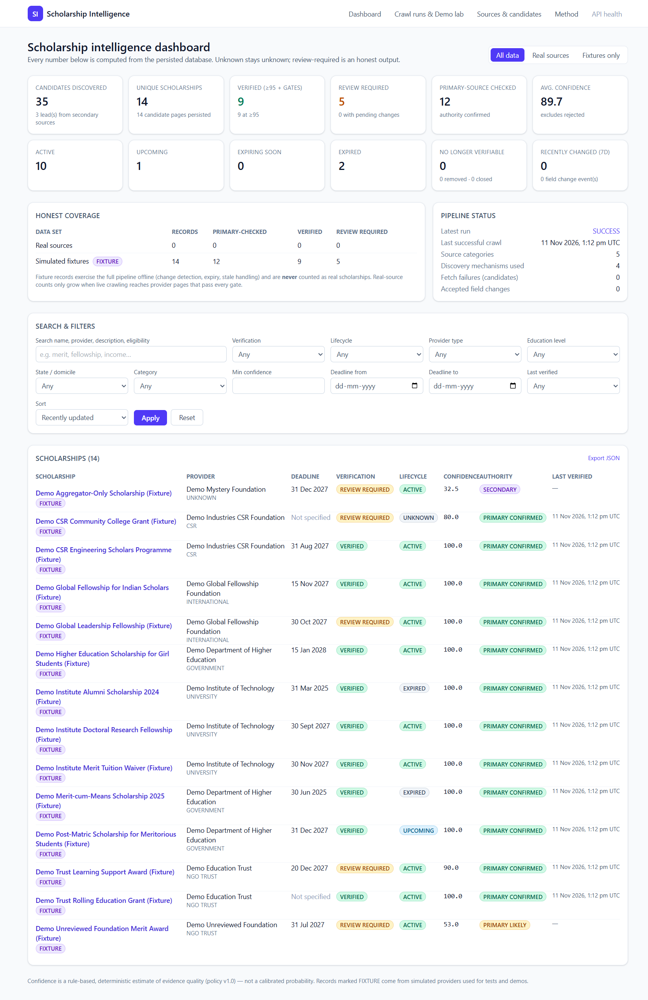

# Scholarship Intelligence Crawler

An evidence-first system that **discovers → classifies → fetches → extracts → resolves the official source → verifies → scores → persists → displays → re-crawls → detects change** for scholarships open to Indian students.
Built as a modular monolith on **Next.js (App Router) + PostgreSQL (Drizzle ORM)**. No paid API, scraping service or LLM is required; everything works without any keys.

## Quick start

```bash
cp .env.example .env            # set DATABASE_URL (keys below are all OPTIONAL)
npm install
npx drizzle-kit push            # creates the schema
npm run build && npm start      # dashboard on http://localhost:3000
```

Then open **Crawl runs & Demo lab** and press *Start crawl* (scope: simulated fixtures works fully offline), or use the CLI:

```bash
npx tsx scripts/run-crawl.ts --scope FIXTURES          # offline, deterministic pipeline run
npx tsx scripts/run-crawl.ts --scope LIVE --max-pages 40   # real provider sites (robots.txt + rate limits respected)
npx tsx scripts/run-crawl.ts --reverify-only           # re-observe existing records only
npx tsx scripts/demo.ts                                # scripted demo: idempotency, 2 change events, expiry, stale handling
npx vitest run                                         # unit tests (scoring, extraction, dedup, lifecycle, robots)
```

## Run locally with Ollama

Tested with Ollama + `llama3.2:3b` (2 GB) and Postgres on Windows.

```bash
ollama pull llama3.2:3b
docker run -d --name scholar-pg -e POSTGRES_PASSWORD=postgres -e POSTGRES_DB=app_db -p 5432:5432 postgres:16-alpine
cp .env.example .env     # then set OLLAMA_ENABLED=true and OLLAMA_MODEL=llama3.2:3b
npm install && npx drizzle-kit push --force
npx tsx scripts/run-crawl.ts --scope FIXTURES --max-pages 4   # ~12 s, 22 pages, 14 records
npm run build && npx next start -p 3100
```

The Ollama stage only runs for pages where the rules left `eligibility_summary`, `selection_process` or `renewal_requirements` empty, and every quote it returns is validated against the page text. Temperature 0, one request per page, input capped at 12k chars, so token use stays small.



Result of the minimal run above: 22 pages ok, 14 records, 9 VERIFIED, 5 REVIEW_REQUIRED. A 3-page `--scope LIVE` run reached reliance_foundation, chevening, scholarships.gov.in and ugc.gov.in, but persisted 0 real records (AICTE timed out), so real-source counts stay 0.

## Vercel

The UI and API deploy to Vercel, but they need a hosted Postgres (`DATABASE_URL`, e.g. Neon or Supabase). A Vercel deployment cannot reach your local Ollama, so run crawls locally against the same hosted DB.

## What is real and what is simulated

| Layer | Behaviour |
|---|---|
| **Live sources** (`config/source_policy.yaml`) | Government portals/regulators, a trust, a CSR foundation and an international programme. Fetched over HTTP(S) with robots.txt, per-domain delay, retries/backoff, size limits, PDF support. Whatever passes every gate is stored; whatever doesn't is stored as `REVIEW_REQUIRED` or kept as a candidate. **The system never inflates counts**: real vs. fixture numbers are shown separately on the dashboard. Many official sites are slow, JS-rendered or block bots, so live yield depends on your network. |
| **Fixture sources** (`fixture://…`) | *Simulated* providers (clearly named “Demo … (Fixture)”, flagged `FIXTURE` everywhere) used to prove the full pipeline offline and to run **controlled** change-detection / expiry / stale demonstrations. They are never counted as real scholarships. |

The seed domains were chosen from each provider's well-known public presence and are marked `reviewed: true` in the registry; **a human reviewer must re-confirm domain ownership, robots.txt and terms before relying on them** (set `reviewed: false` to downgrade a source to `PRIMARY_LIKELY`, which can never be `VERIFIED`).

## Architecture (modules in `src/lib`)

| Module | Responsibility |
|---|---|
| `discovery/` | link relevance scoring (priority only), sitemap parsing, official cross-links, aggregator leads, optional SearXNG search leads |
| `crawling/` | fetcher (retries, backoff, delay, size/type limits, PDF), robots.txt, HTML/PDF → normalised text (tables keep row labels), fixture provider |
| `extraction/` | deterministic evidence-first extractor; optional Ollama stage whose output is quote-validated and capped at *partially supported* |
| `verification/` | source resolver (registry + provider identity), versioned deterministic confidence policy, mandatory gates |
| `lifecycle/` | ACTIVE / EXPIRING_SOON / UPCOMING / EXPIRED / CLOSED / NO_LONGER_VERIFIABLE / REMOVED / UNKNOWN; failure ≠ removal |
| `services/` | `crawl` (orchestration, job lock, run log), `persist` (one transaction: change events + immutable version + current record + verification), `review`, `queries` |
| `app/api/v1/*` | `health, metrics, scholarships, scholarships/{id}[/evidence|history|changes|reverify|review], runs, runs/{id}, sources, candidates, fixtures, export` |
| `app/*` | dashboard, scholarship detail (evidence, confidence breakdown, history), runs & demo lab, sources & candidates, method page |

Database (Drizzle, `src/db/schema.ts`): `sources, crawl_runs, discovered_candidates, fetch_observations, scholarships, scholarship_versions, evidence, field_evidence, verification_results, change_events, review_actions, job_locks, fixture_state`.

### Trust rules implemented
* Every non-null field carries an exact quote that must exist in the stored text, else it is **dropped** (`droppedFields`).
* `VERIFIED` ⇔ score ≥ 95 **and** all gates: primary source confirmed · official presence (fresh) · critical fields supported · provenance complete · no unresolved conflict (+ India-eligibility evidence for international providers).
* Aggregators are leads only; their pages never overwrite primary-confirmed facts (`DUPLICATE_LEAD`).
* Unknown stays `null` ("Not specified by the official source"); years are never guessed; conflicting deadlines are not silently resolved.
* Change detection compares normalised fields. Auto-accept only from confirmed primary sources; eligibility changes, field removals and conflicts become **pending review** (previous value stays current). Identical re-crawls create no versions or events.
* A failed fetch is stored as an observation and never removes a record; `NO_LONGER_VERIFIABLE` needs ≥3 consecutive failures **and** a 14-day grace period; `REMOVED` needs explicit provider wording.
* Runs are guarded by a DB job lock; the optional scheduler (`SCHEDULER_ENABLED=true`) re-checks records that are due.

## Demonstrations (all reproducible on one database)
1. **Repeat run** – run the fixture crawl twice: observations grow, versions/events don't.
2. **Two change events** – Demo lab → switch `fx-dept-postmatric` and `fx-univ-phd` to *Version B* → crawl: closing-date and benefit changes with old/new values, evidence and observation IDs.
3. **Expired** – `fx-dept-meritmeans`, `fx-univ-expired` publish past deadlines → `EXPIRED`.
4. **Stale** – switch `fx-trust-rolling` to *503* and crawl with simulated clock +20d/+25d/+30d → `NO_LONGER_VERIFIABLE` only on the third failure. Events created with a simulated clock are labelled.

## Optional environment (`.env.example`)
`OLLAMA_*` (local LLM aid), `SEARXNG_URL`/`SEARCH_QUERIES` (free self-hosted lead discovery), `SCHEDULER_ENABLED`, `CRAWLER_USER_AGENT`. Placeholders for third-party keys exist but are never needed.

## Known limits
* No JS rendering (Playwright) and no OCR yet; JS-only pages report `EMPTY_CONTENT` for manual review.
* Extraction is rule-based English-language; unusual layouts may yield fewer fields (they stay `null`, and the record goes to review).
